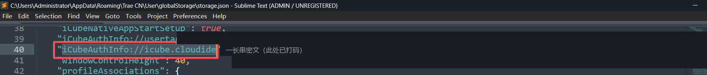

# Trae 多账号管理面板

自托管的 **Trae CN 多账号管理面板**：统一管理多个账号，自动每日签到、定时刷新用量、
监控积分消耗、留存历史与日志，支持邮件 / 企业微信通知，**Docker 一键部署到服务器**。

架构参考了 [workbuddy2api-panel](https://github.com/linguo2625469/workbuddy2api-panel)：
Web 管理面板 + 多账号池 + 定时任务 + 用量视图 + 单命令部署。本项目聚焦 Trae CN，
不含对外 API 网关。

## 功能

| 能力 | 说明 |
|---|---|
| 🔑 **多账号管理** | 面板导入 / 删除账号；导入即解密并保存凭证，自动用 refreshToken 续期 |
| ⏰ **自动签到** | 每日定时（可配多个时刻）对全部账号签到，幂等安全，可手动一键触发 |
| 🧭 **任务中心** | 按账号 × 任务展示完成状态并支持一键执行（当前内置「每日签到」「用量快照」） |
| 📊 **用量监控** | 查询积分总量 / 已消耗 / 剩余 / 积分包到期，按天留存历史并出趋势图 |
| 🔔 **通知** | 邮件（SMTP）+ 企业微信机器人，开关独立，支持测试发送 |
| 🖥️ **Web 面板** | 概览 / 账号 / 用量 / 任务 / 日志 / 设置六个视图，访问密钥保护 |
| 🐳 **一键部署** | `docker-compose` 单命令拉起，`.env` 填 key 即可 |

## 原理

不打开客户端、不模拟点击：脚本直接解密本机客户端保存的登录态（`iCubeAuthInfo://icube.cloudide`，
tc 加密格式），提取 accessToken / refreshToken，然后调用官方接口：

- 签到状态：`POST api.trae.cn/trae/api/v2/ug/checkin_credits/status`
- 领取积分：`POST api.trae.cn/trae/api/v2/ug/checkin_credits/claim`
- 用量查询：`POST api.trae.cn/trae/api/v2/pay/ide_user_ent_usage`
- 令牌续期：`POST api.trae.cn/cloudide/api/v3/trae/oauth/ExchangeToken`

> 上述接口与加解密为逆向自官方客户端的非公开实现，可能随客户端版本变化。仅限管理**你自己的账号**。

## 快速开始（服务器 Docker 一键部署）

在服务器上：

```bash
git clone https://github.com/RepomanWu/trae-auto-checkin.git trae-checkin
cd trae-checkin
./deploy.sh
```

`deploy.sh` 会自动生成 `.env`（含随机面板密钥）并 `docker compose up -d --build`。
完成后输出面板地址，浏览器打开 `http://<服务器IP>:7864`，输入 `.env` 里的 `ADMIN_KEY` 即可。

手动方式：

```bash
cp .env.example .env    # 填写 ADMIN_KEY（面板密钥 = key）与 PORT
docker compose up -d --build
```

> 打不开时确认服务器安全组 / 防火墙已放行对应端口。
> 若提示 `Permission denied`，说明文件没有可执行位，用 `bash deploy.sh` 或 `chmod +x deploy.sh` 再执行。

### 用 Skill 一键部署（可选）

仓库内置了部署 Skill：[.trae/skills/trae-auto-checkin/SKILL.md](.trae/skills/trae-auto-checkin/SKILL.md)。
在 Trae 中打开本仓库，或把该技能目录导入为外部技能，然后直接说「部署 trae-auto-checkin」，
助手会按 Skill 里的步骤完成拉取、部署、导出账号与配置。

## 国内服务器加速

国内服务器直连 Docker Hub / PyPI 很慢，首次构建可能长时间停在拉取 `python:3.11-slim`（约 130MB）。
这不是卡死，是网速问题。两种加速方式任选：

**方式 1：配置 Docker 镜像加速器（推荐，对整台机器生效）**

阿里云 ECS 在「容器镜像服务 → 镜像工具 → 镜像加速器」里有专属加速地址：

```bash
sudo mkdir -p /etc/docker
sudo tee /etc/docker/daemon.json >/dev/null <<'EOF'
{
  "registry-mirrors": ["https://<你的专属加速地址>.mirror.aliyuncs.com"]
}
EOF
sudo systemctl daemon-reload && sudo systemctl restart docker

docker pull python:3.11-slim   # 先单独拉一下，验证速度
```

**方式 2：直接换镜像源（改 `.env`，不用动系统配置）**

```bash
# .env 里取消注释并按需修改
PYTHON_BASE=docker.m.daocloud.io/library/python:3.11-slim
PIP_INDEX_URL=https://pypi.tuna.tsinghua.edu.cn/simple
```

改完重新执行 `./deploy.sh`（镜像地址以你实测可用的为准）。

> 构建期间想确认「慢」还是「卡死」：另开一个终端跑 `docker compose build --progress=plain`
> 看当前步骤，`docker images` 可看基础镜像是否已拉下来。

## 添加账号（关键步骤）

服务器上没有 Trae 客户端，登录态需要从**你本机**（已登录 Trae 客户端的那台机器）导出。
登录态密文存在客户端本地文件里，键名固定为 `iCubeAuthInfo://icube.cloudide`。
下面两种方式任选其一。

### 方式 A：用导出脚本（推荐）

1. 在本机进入项目目录，安装依赖后运行：

   ```bash
   pip install cryptography
   python export_local.py
   ```

   脚本会扫描 `%APPDATA%` 下的 `Trae CN` / `TRAE SOLO CN` / `Trae` / `TRAE SOLO`，
   输出 `trae_export.json`，并把每个账号的**密文**打印到终端（形如 `dGMFEA...` 的一长串）。

2. 复制终端里打印的整串密文，打开面板 →「账号」→ 粘贴到「登录态密文」→（可选）填备注名 →「导入账号」。

   > 脚本只扫描**当前 Windows 账号**的 `%APPDATA%`。如果 Trae 是在别的账号下登录的，
   > 请切到那个账号再运行，或用下面的方式 B。

### 方式 B：手动从 storage.json 复制密文

不跑脚本也行，直接从客户端存储文件里取：

1. 用任意文本编辑器打开这个文件（把 `Trae CN` 换成你实际的客户端目录名）：

   ```
   %APPDATA%\Trae CN\User\globalStorage\storage.json
   ```

   完整路径形如 `C:\Users\<你的用户名>\AppData\Roaming\Trae CN\User\globalStorage\storage.json`。

2. 搜索 `icube.cloudide`，找到键名为 `iCubeAuthInfo://icube.cloudide` 的那一行，
   它右边是一长串 base64 密文：

   

   （图中红框是键名，"值"的部分已打码；你打开时那里是真实密文。）

3. 复制**值**：从该键后面第一个双引号，到这一行结尾的那个双引号为止，整段都要。
   通常有 2000 多个字符，注意别漏掉结尾，也别把引号复制进去。

4. 粘贴到面板 →「账号」→「登录态密文」→「导入账号」。

导入后服务端会解密并保存凭证。密文只在你本机与你自己服务器之间流转，不经过第三方。

> ⚠️ `storage.json` 与 `trae_export.json` 都含可解出账号令牌的密文，属敏感文件：
> 不要提交到仓库、不要发给他人；导入完成后建议删除 `trae_export.json`。

## 配置（key 与来源）

面板「设置」视图可在线修改，保存后**热生效**（无需重启）：

- **面板访问密钥（key）**：保护面板与接口；留空表示不校验（仅建议内网/本机）。
- **签到来源（模型/来源口径）**：`1 = Trae CN（IDE / Work）`，`2 = SOLO / 企业版`。
- **签到时间 / 用量刷新间隔 / 时区 / 历史保留天数**。
- **通知**：邮件 SMTP、企业微信 webhook，含「发送测试通知」。

也可用环境变量注入（适合 Docker）：`TRAE_PANEL_ADMIN_KEY`、`TRAE_PANEL_PORT`、`TRAE_PANEL_HOST`、`TZ`。

## 任务中心说明（重要）

Trae CN 官方目前**可稳定调用**的自动化接口只有「每日签到」与「用量查询」；
官方「成长任务」类接口**未公开**，社区也无可验证的逆向成果，因此本项目**不臆造接口**，
只内置上述两个已验证任务。

扩展方式：在 `trae_panel/service.py` 的 `TASKS` 里加一条任务元数据，
并实现对应的处理函数（放到 `run_task` 的分支），面板会自动出现该任务。

## 目录结构

```
trae_panel/          服务端（FastAPI）
  config.py          配置加载/保存（data/config.json + 环境变量）
  crypto.py          tc 登录态解密、令牌刷新、出站指纹头
  api.py             Trae 接口调用（含 401 自动刷新、瞬时错误重试）
  store.py           账号与历史落盘（原子写）
  service.py         业务编排：导入、签到、任务、用量快照、通知
  notify.py          邮件 / 企业微信
  log.py             面板运行日志
  web.py             FastAPI 路由 + 定时调度
  __main__.py        入口：python -m trae_panel
panel/index.html     内嵌 Web 面板（无构建依赖）
export_local.py      本机登录态导出工具
Dockerfile / docker-compose.yml / deploy.sh / .env.example
```

## 本地直接运行（不走 Docker）

```bash
pip install -r requirements.txt
python -m trae_panel          # 监听 0.0.0.0:7864
```

本机想保留原有的 Windows 定时签到脚本，见文末「本机脚本」。

## 数据与安全

- 账号凭证（含明文令牌）保存在 `data/accounts.json`，仅供服务端调用官方接口。
  **请勿把 `data/` 提交到公开仓库**；Docker 部署时它只挂载在你自己的卷里。
- 面板接口需要 `X-Admin-Key`，请务必设置 `.env` 的 `ADMIN_KEY`。
- 出站请求带固定的设备/机器指纹（导入时生成并持久化），保持稳定、避免指纹漂移。
- 日志与面板响应都不会回显令牌。

## 常见问题

- **签到返回「登录态已失效」**：refreshToken 也过期了，去本机客户端重新登录一次，再导出密文重新导入。
- **签到不可用 / enable=false**：账号当日未满足条件或活动调整，面板日志会给出原始返回。
- **积分数字**：面板展示的是官方用量接口返回的总量 / 已消耗 / 剩余；签到奖励是当日签到所得，二者含义不同。

## 本机脚本（原有，可选）

仓库仍保留本机 Windows 版脚本，适合"就在装了客户端的机器上定时签到"：

| 文件 | 作用 |
|---|---|
| `checkin_trae.py` | 本机签到脚本（读取本机登录态，直连官方接口，可多账号） |
| `config.example.json` | 配置模板：复制为 `config.json` 后填写（含通知邮箱 / 授权码，已被 `.gitignore` 排除） |
| `install_checkin.cmd` / `run_checkin.cmd` / `uninstall_checkin.cmd` | 安装 / 立即执行 / 卸载计划任务 |

> 服务器面板与它二选一即可，互不冲突。
